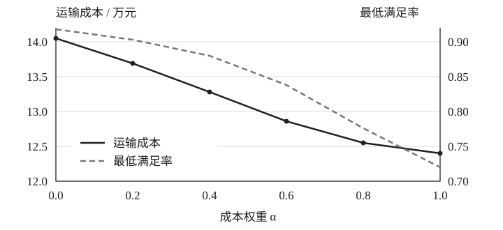

# 应急物资的多目标调度模型与分析

## 摘要

面对应急救援中需求分散、运输资源有限与时效要求较高等特点，本文构建兼顾运输成本与需求满足程度的多目标调度模型。为便于展示论文排版，本文采用模拟数据进行分析，所有数值均为演示结果，不代表真实地区的救援能力或实际决策建议。

首先，根据物资需求量、仓储能力与运输时间建立配送网络，将不同量纲的目标归一化，避免某一指标因取值范围较大而主导优化过程。在总供给量与车辆运力约束下，以各需求点的满足率刻画服务水平，并通过最低保障约束限制区域之间的分配差异，从而将成本控制与公平性要求纳入同一分析框架。

其次，采用加权求和方法生成一组候选方案，通过改变成本权重分析成本与保障水平之间的关系。模拟结果表明，相较于仅考虑运输距离的基准方案，综合方案在增加少量运输成本的情况下，可以提高最低需求满足率，并降低不同需求点之间的服务差异。在本文设定的算例中，综合方案的最低满足率由 0.72 提升至 0.88。

最后，对需求规模与运输时间开展扰动分析。结果显示，模型对小幅参数变化具有一定稳定性；当需求增长超过现有储备的保障范围时，单纯调整运输路线无法继续改善分配结果，需要引入额外供给或分阶段配送机制。模型具有结构清晰、约束含义明确等优点，也存在依赖需求估计、未充分考虑道路中断等局限，可为后续动态调度研究提供基础。

**关键词：** 应急调度；多目标优化；线性规划；敏感性分析

## 1 问题重述

应急物资调度需要在有限资源下及时回应多个需求点。不同地区的需求规模、道路条件与保障优先级存在差异，若仅以总运输费用为目标，可能形成局部效率较高、整体分配不均的结果。因此，调度方案应同时关注资源利用效率与基本服务保障。

本文研究单个配送周期内的静态调度问题：已知各仓库的可用物资量、各需求点的需求规模及仓库之间的运输参数，确定每条配送线路上的物资分配量。研究重点包括模型的建立、候选方案的比较，以及关键参数变化时方案的稳定性。

## 2 模型假设与符号说明

### 2.1 基本假设

1. 同一类物资可按统一单位计量，配送过程中不发生损耗。
2. 一个配送周期内需求与可用储备保持不变，运输成本与配送量近似成正比。
3. 仓库之间不进行中转，各需求点可以同时由多个仓库供给。
4. 道路通行条件已知，极端中断情形在敏感性分析中另行讨论。

### 2.2 符号说明

表 1　模型主要符号及含义

| 符号 | 含义 | 单位 |
| :---: | :--- | :---: |
| $x_{ij}$ | 仓库 $i$ 向需求点 $j$ 配送的物资量 | 吨 |
| $s_i$ | 仓库 $i$ 的可用储备量 | 吨 |
| $d_j$ | 需求点 $j$ 的需求量 | 吨 |
| $c_{ij}$ | 单位物资的线路运输成本 | 元 / 吨 |
| $r_j$ | 需求点 $j$ 的需求满足率 | — |
| $\alpha$ | 运输成本在综合目标中的权重 | — |

## 3 模型的建立与求解

### 3.1 目标函数

在单周期配送网络中，总运输成本可写为各线路配送量与单位成本的乘积之和。为同时考虑服务水平，使用各需求点未满足比例的平均值衡量整体缺口。两个指标经过归一化后，综合目标为

\[
\min Z = \alpha\frac{\sum_{i=1}^{m}\sum_{j=1}^{n}c_{ij}x_{ij}}{C_0}
+ (1-\alpha)\frac{1}{n}\sum_{j=1}^{n}(1-r_j),\qquad 0\leq\alpha\leq1.
\tag{1}
\]

其中，$C_0$ 为给定的参考成本，用于消除费用指标的量纲影响。权重 $\alpha$ 越大，模型越倾向于选择运输费用较低的方案；权重较小时，模型更关注需求保障程度。权重应结合具体任务确定，不能仅凭单个算例认定存在普适的最优取值。

### 3.2 约束条件

配送总量不能超过仓库储备，需求点接收量不能超过需求量，且各线路的配送量均应非负。需求满足率由到达物资量与需求量的比值定义：

\[
\begin{aligned}
\sum_{j=1}^{n}x_{ij} &\leq s_i, && i=1,\ldots,m,\\
\sum_{i=1}^{m}x_{ij} &\leq d_j, && j=1,\ldots,n,\\
r_j &= \frac{\sum_{i=1}^{m}x_{ij}}{d_j}, && r_j\geq r_{\min},\\
x_{ij} &\geq 0. &&
\end{aligned}
\tag{2}
\]

最低保障水平 $r_{\min}$ 为模型提供公平性约束。若总供给不足以满足该约束，模型应报告不可行，而非输出违反保障条件的方案。实际使用时可以设置分级保障目标，并对无法满足的需求单独记录和解释。

### 3.3 求解流程

首先检查需求量与储备量的有效性，再根据运输网络生成线性约束矩阵。随后在预设权重区间内逐点求解，剔除不可行方案，并记录每个方案的总成本、最低满足率与服务差异。最后结合决策偏好选择折中方案，并通过扰动分析检验其稳定性。

```text
输入：储备、需求、单位运输成本与最低保障水平
检查：数据有效性及总供给是否满足最低保障
循环：对每个候选权重求解线性规划
输出：可行方案、目标指标及约束检验结果
```

## 4 结果与分析

### 4.1 候选方案比较

为展示不同目标之间的权衡，构造三个仓库、六个需求点的模拟配送网络。表 2 给出三种候选方案的主要指标。所有指标仅用于演示排版与分析过程，各方案采用相同的总供给条件与需求数据。

表 2　不同调度方案的模拟结果

| 方案 | 总成本 / 万元 | 最低满足率 | 满足率标准差 |
| :--- | ---: | ---: | ---: |
| 距离优先 | 12.40 | 0.72 | 0.091 |
| 综合均衡 | 12.86 | 0.88 | 0.037 |
| 保障优先 | 13.62 | 0.92 | 0.021 |

综合方案相对于距离优先方案的成本增加约 3.7%，最低需求满足率提高 16 个百分点。该结果说明，在当前算例中，适度增加运输投入可以显著改善薄弱需求点的保障水平。继续提高保障水平时，成本增幅加快，反映出不同目标之间的边际替代关系。



图 1 展示了成本权重变化时的方案表现。随着成本权重增加，运输费用逐渐下降，而最低满足率也出现回落。图中采用实线与虚线区分指标，使灰度打印后仍能辨别曲线，无需依赖颜色识别结果。

### 4.2 需求扰动分析

保持运输网络不变，将总需求在基准情形上下浮动 10%，分别计算综合方案。需求下降时，资源约束得到缓解；需求上升时，最低保障约束逐渐接近可行边界。在此过程中，需要同时检查平均保障水平与个别区域的分配结果，避免只观察总体指标。

表 3　需求规模扰动下的模拟结果

| 需求变化 | 总成本 / 万元 | 最低满足率 | 可行性 |
| :---: | ---: | ---: | :---: |
| −10% | 11.95 | 0.96 | 可行 |
| 基准 | 12.86 | 0.88 | 可行 |
| +10% | 13.31 | 0.80 | 可行 |

进一步提高需求水平后，现有储备无法满足最低保障要求。此时应将模型结果解释为供给能力不足的信号，优先考虑外部补给、配送批次调整与重点区域保障，而不是继续寻找形式上更低的目标值。

## 5 模型评价与改进

本文模型将成本、需求满足程度与最低保障约束纳入统一框架，目标与约束均具有明确含义，便于复核输入数据和解释方案差异。线性规划结构也使得候选方案之间的比较较为直接，有利于在参数变化后快速重新计算。

模型的主要局限在于静态需求假设与线性运输成本假设。实际应急任务中，需求可能随时间增长，道路状态与车辆到达时间也存在不确定性。后续可以采用滚动优化方法更新需求估计，并将道路中断、车辆调度与库存补给纳入多阶段模型。

## 参考文献

1. Boyd S, Vandenberghe L. Convex Optimization. Cambridge University Press, 2004.
2. Dantzig G B. Linear Programming and Extensions. Princeton University Press, 1963.
